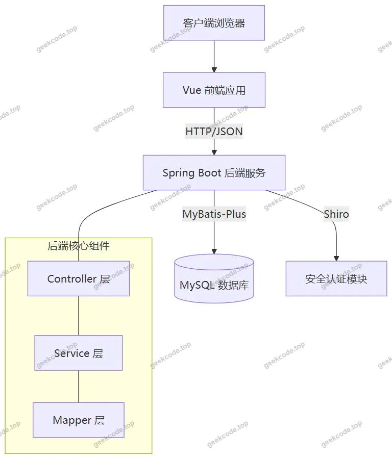
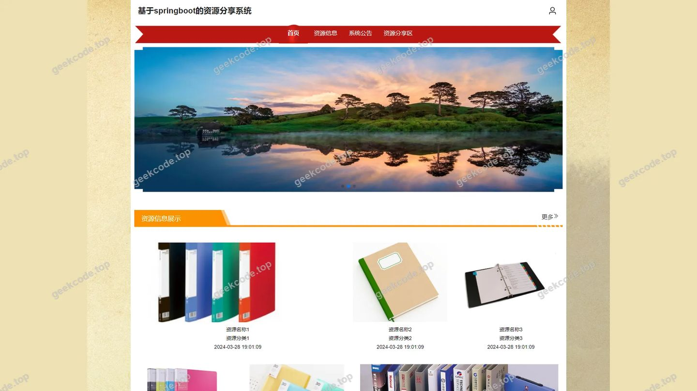
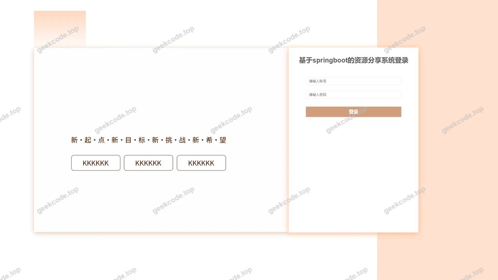
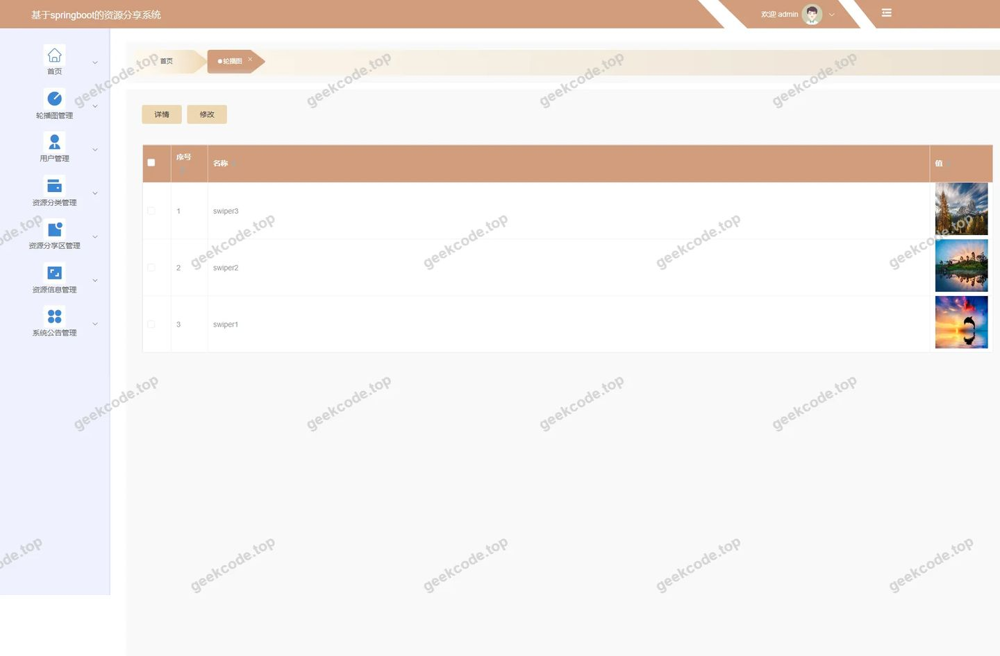
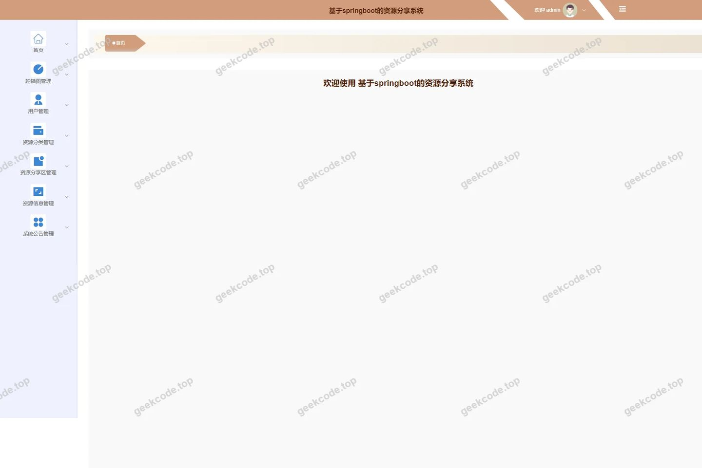
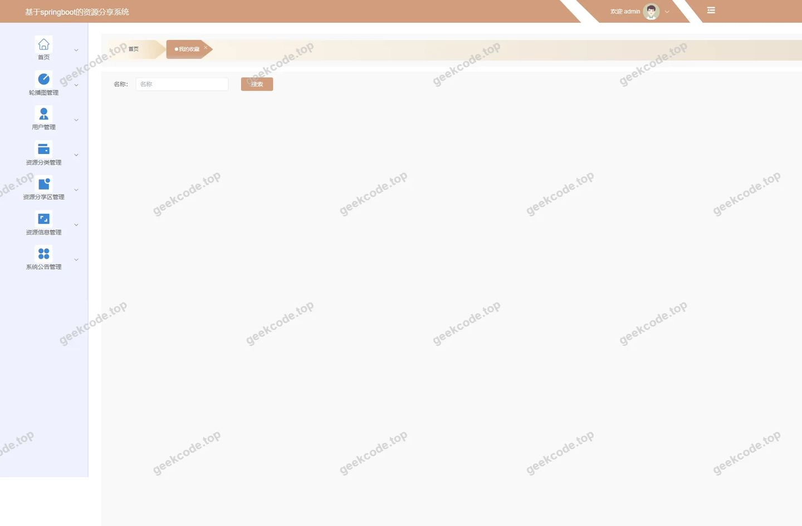
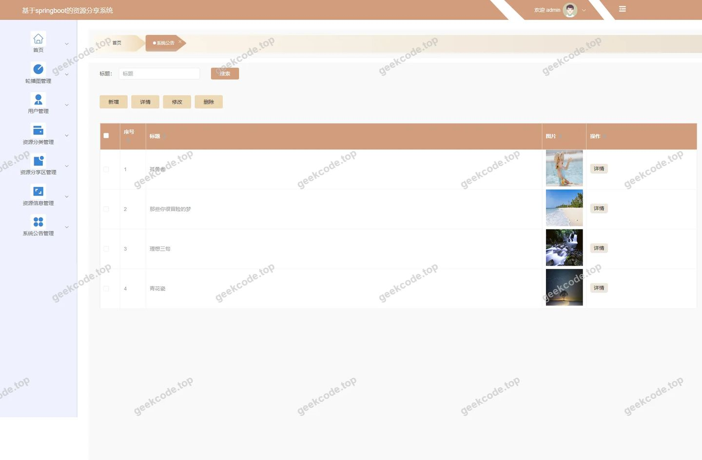
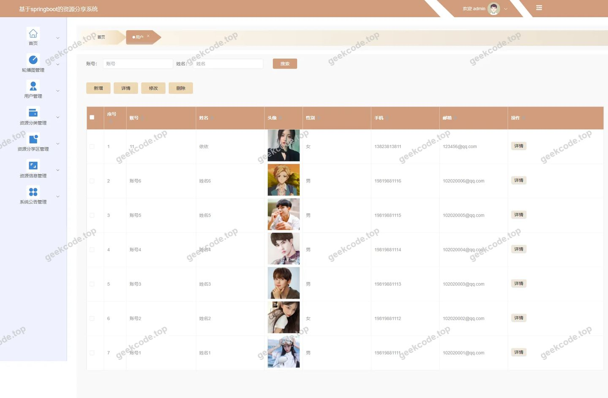
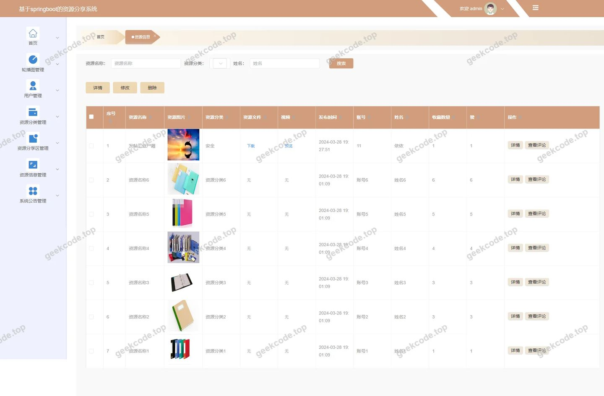
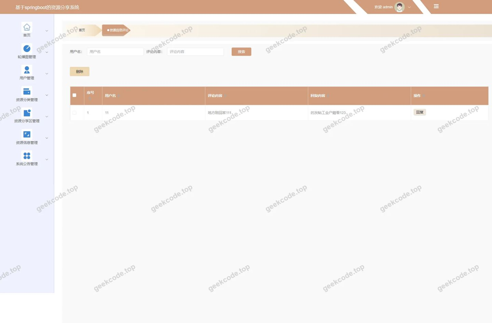

# [springboot]基于springboot的资源分享系统

> 🎓 **计算机毕业设计 · [springboot]基于springboot的资源分享系统**
>
> 本仓库只放**项目介绍 + 运行截图**（截图是站点带水印的原图，存在仓库 `images/` 里）。
>
> 👉 **完整可运行源码 / 数据库脚本 / 部署文档：[点我获取](https://geekcode.top/archives/springboot-%E5%9F%BA%E4%BA%8Espringboot%E7%9A%84%E8%B5%84%E6%BA%90%E5%88%86%E4%BA%AB%E7%B3%BB%E7%BB%9F?utm_source=github)**
>
> 💬 咨询微信：**ir9372**　|　🌐 更多项目：[极客代码 geekcode.top](https://geekcode.top/?utm_source=github)
>
> 📌 项目详情页：<https://geekcode.top/archives/springboot-%E5%9F%BA%E4%BA%8Espringboot%E7%9A%84%E8%B5%84%E6%BA%90%E5%88%86%E4%BA%AB%E7%B3%BB%E7%BB%9F?utm_source=github>

<table><td width="230" align="center"> <b>扫码加微信 ir9372</b></td><td valign="middle">📦 源码 = 项目介绍 + 全部运行截图 + 数据库 + 部署文档 👉 点上方任意截图，直接跳到 <b>极客代码 geekcode.top</b> 详情页</td></table>

---

<h1>[springboot]基于springboot的资源分享系统</h1>
<h2>项目概述</h2>

本项目是一个基于 Spring Boot 和 Vue 技术栈构建的资源分享系统，旨在提供一个高效、便捷的网络资源交流与共享平台。系统核心功能涵盖资源信息的发布与管理、用户互动评论、论坛交流以及个人中心维护等模块。通过前后端分离的架构设计，实现了前台用户端的资源浏览、注册登录、信息编辑及收藏功能，以及后台管理端对资源分类、公告发布、用户管理及评论审核的全方位控制。适用人群包括需要分享或获取网络资源的普通用户以及负责内容运营与系统维护的管理员。技术架构上采用 MyBatis-Plus 简化数据持久层操作，Shiro 框架保障系统安全认证与授权，MySQL 作为数据存储核心，整体设计严谨，具备良好的扩展性与稳定性。

<h2>技术架构</h2>
<h3>1. 总体架构设计</h3>

本系统采用经典的前后端分离架构（Vue-integrated），前端负责视图渲染与交互逻辑，后端提供 RESTful API 接口服务。

<h3>2. 核心技术选型理由</h3>
<ul>
<li><strong>Spring Boot</strong>: 作为后端基础框架，利用其“约定优于配置”的特性，快速搭建微服务或单体应用结构，内置 Tomcat 容器便于部署，且生态丰富，易于集成各类插件。</li>
<li><strong>MyBatis-Plus</strong>: 在 MyBatis 基础上增强，提供了通用的 CRUD 操作接口和条件构造器，大幅减少了样板代码的开发量，提升了数据访问层的开发效率与维护性。</li>
<li><strong>Apache Shiro</strong>: 轻量级 Java 安全框架，用于处理身份验证（Authentication）、授权（Authorization）和密码加密。相比 Spring Security，Shiro 更简洁易用，适合中小型项目的权限管控需求。</li>
<li><strong>Vue.js</strong>: 前端采用渐进式 JavaScript 框架，通过组件化开发模式提升页面复用率，结合 Axios 进行异步请求，实现流畅的用户体验。</li>
<li><strong>MySQL</strong>: 关系型数据库管理系统，成熟稳定，支持事务处理，适用于存储用户信息、资源详情、评论记录等结构化数据。</li>
</ul>
<h3>3. 数据库设计要点</h3>

根据路由和功能模块推断，数据库主要包含以下核心实体表：

<ul>
<li><strong>用户表 (yonghu)</strong>: 存储用户基本信息、账号密码、角色标识等。</li>
<li><strong>资源信息表 (ziyuanxinxi)</strong>: 存储分享的资源标题、内容、分类ID、发布时间、作者等。</li>
<li><strong>资源分类表 (ziyuanfenlei)</strong>: 定义资源的类别体系，支持层级或扁平分类。</li>
<li><strong>评论表 (discussziyuanxinxi)</strong>: 关联资源ID与用户ID，存储评论内容、时间及状态。</li>
<li><strong>收藏表 (storeup)</strong>: 记录用户对特定资源的收藏行为。</li>
<li><strong>论坛/公告表 (forum/news)</strong>: 分别存储社区讨论帖和系统官方公告。</li>
<li><strong>配置表 (config)</strong>: 存储轮播图、系统参数等动态配置信息。</li>
</ul>
<h2>功能模块</h2>
<h3>1. 前台用户端功能</h3>

前台面向普通注册用户，提供资源浏览、互动及个人信息管理功能。

<ul>
<li><strong>首页展示 (<code>/index</code>)</strong>:</li>
<li><strong>新闻列表 (<code>/index/newsList</code>)</strong>: 展示系统发布的最新公告或资讯。</li>
<li><strong>论坛列表 (<code>/index/forumList</code>)</strong>: 显示社区讨论主题，支持点击进入详情。</li>
<li><strong>资源入口</strong>: 导航至资源分类与详细信息页面。</li>
<li><strong>用户中心 (<code>/index/yonghuCenter</code>)</strong>:</li>
<li><strong>个人信息管理 (<code>/index/yonghuDetail</code>, <code>/index/yonghuAdd</code>)</strong>: 允许用户查看和修改个人资料，如昵称、头像、联系方式等。</li>
<li><strong>我的收藏 (<code>/index/storeupList</code>)</strong>: 展示用户已收藏的资源列表，支持取消收藏。</li>
<li><strong>注册与登录 (<code>/yonghuRegister</code>, <code>/front-login</code>)</strong>: 新用户注册账号，老用户登录系统。</li>
<li><strong>资源管理与浏览</strong>:</li>
<li><strong>资源分类 (<code>/index/ziyuanfenleiList</code>, <code>/index/ziyuanfenleiDetail</code>)</strong>: 按类别筛选资源，查看分类描述。</li>
<li><strong>资源详情 (<code>/index/ziyuanxinxiDetail</code>)</strong>: 查看具体资源的详细内容、下载链接或文本介绍。</li>
<li><strong>资源发布 (<code>/index/ziyuanxinxiAdd</code>)</strong>: 用户上传或创建新的资源信息。</li>
<li><strong>资源评论</strong>: 用户在资源详情页发表看法，参与讨论。</li>
</ul>
<h3>2. 后台管理端功能</h3>

后台面向管理员，提供全站数据的监控、维护与管理功能。

<ul>
<li><strong>仪表盘 (<code>/admin-home</code>)</strong>: 展示系统关键指标概览（截图显示为“页面-首页”）。</li>
<li><strong>资源信息管理 (<code>/ziyuanxinxi</code>)</strong>:</li>
<li>对前台发布的资源进行审核、编辑、删除或下架操作。</li>
<li>查看资源详情及关联的评论情况。</li>
<li><strong>资源分类管理 (<code>/ziyuanfenlei</code>)</strong>:</li>
<li>新增、修改或删除资源分类标签，优化资源组织结构。</li>
<li><strong>用户管理 (<code>/yonghu</code>)</strong>:</li>
<li>查看所有注册用户列表，执行禁用、重置密码或删除操作。</li>
<li><strong>评论管理 (<code>/discussziyuanxinxi</code>)</strong>:</li>
<li>审核用户发表的评论，屏蔽违规内容，维护社区秩序。</li>
<li><strong>论坛管理 (<code>/forum</code>)</strong>:</li>
<li>管理社区帖子，包括置顶、加精或删除不当言论。</li>
<li><strong>系统公告/新闻管理 (<code>/news</code>)</strong>:</li>
<li>发布和维护系统通知、活动公告或行业资讯。</li>
<li><strong>收藏记录管理 (<code>/storeup</code>)</strong>:</li>
<li>查看用户的收藏行为数据，辅助分析热门资源。</li>
<li><strong>系统配置 (<code>/config</code>)</strong>:</li>
<li><strong>轮播图管理</strong>: 上传、替换首页展示的轮播广告图片（截图显示“后台-轮播图”）。</li>
<li>其他系统参数配置。</li>
</ul>
<h2>用户角色与权限</h2>

本系统主要划分为两个核心角色：<strong>普通用户</strong>和<strong>管理员</strong>。

<h3>1. 普通用户 (User)</h3>
<ul>
<li><strong>权限范围</strong>: 仅限前台操作及个人数据管理。</li>
<li><strong>可访问功能模块</strong>:</li>
<li><strong>公共区域</strong>: 浏览首页、查看新闻公告、浏览论坛列表、查看资源分类、浏览资源详情、阅读评论。</li>
<li><strong>需登录功能</strong>:</li>
<li><strong>个人中心</strong>: 修改个人信息、查看我的收藏列表。</li>
<li><strong>互动功能</strong>: 发布新资源、在资源下发表评论、收藏/取消收藏资源、在论坛发帖（若论坛支持普通用户发帖）。</li>
<li><strong>账户操作</strong>: 注册账号、登录系统、退出登录。</li>
</ul>
<h3>2. 管理员 (Admin)</h3>
<ul>
<li><strong>权限范围</strong>: 拥有后台最高权限，可对全站数据进行 CRUD（增删改查）操作。</li>
<li><strong>可访问功能模块</strong>:</li>
<li><strong>系统登录</strong>: 进入后台管理界面。</li>
<li><strong>内容管理</strong>:</li>
<li><strong>资源管理</strong>: 审核、编辑、删除所有资源信息。</li>
<li><strong>分类管理</strong>: 维护资源分类体系。</li>
<li><strong>评论管理</strong>: 审核、删除用户评论。</li>
<li><strong>论坛管理</strong>: 管理所有论坛帖子。</li>
<li><strong>新闻/公告管理</strong>: 发布、编辑、删除系统公告。</li>
<li><strong>用户管理</strong>: 查看、编辑、禁用或删除普通用户账号。</li>
<li><strong>数据监控</strong>: 查看收藏记录 (<code>/storeup</code>)。</li>
<li><strong>系统设置</strong>: 配置轮播图及其他系统参数 (<code>/config</code>)。</li>
</ul>
<h2>项目特色与创新点</h2>
<ol>
<li>
<strong>完整的内容生态闭环</strong>:
   系统不仅仅提供静态的资源下载，还构建了“资源发布 -&gt; 用户评论互动 -&gt; 论坛社区讨论 -&gt; 个人收藏沉淀”的完整社交化内容生态。这种设计增强了用户粘性，使平台从单纯的文件仓库转变为活跃的知识分享社区。

</li>
<li>
<strong>灵活的资源分类与检索机制</strong>:
   通过独立的 <code>ziyuanfenlei</code>（资源分类）模块，支持多维度的资源归类。前台提供分类列表与详情页，后台提供分类维护接口，使得资源组织更加清晰，便于用户快速定位所需内容。

</li>
<li>
<strong>基于 Shiro 的安全防护体系</strong>:
   引入 Apache Shiro 框架，实现了细粒度的权限控制。确保只有经过身份验证的用户才能进行资源发布、评论和收藏操作，同时严格隔离后台管理接口，防止未授权访问，保障了用户数据与系统配置的安全性。

</li>
<li>
<strong>前后端分离的高效开发模式</strong>:
   采用 Vue + Spring Boot 的技术组合，前端专注于用户体验与页面渲染，后端专注于业务逻辑与数据处理。这种架构降低了耦合度，提升了系统的可维护性和扩展性，同时也利于团队并行开发。

</li>
<li>
<strong>直观的数据可视化与管理</strong>:
   后台集成了轮播图配置、公告发布等功能，管理员可以实时调整前台展示内容（如首页轮播图），无需重新部署代码即可更新运营策略，提升了系统的运营灵活性。

</li>
</ol>
<h2>部署环境</h2>

为了确保系统的正常运行，建议部署环境如下：

<h3>1. 软件环境要求</h3>
<ul>
<li><strong>操作系统</strong>: Windows 7/10/11, Linux (CentOS 7+, Ubuntu 18.04+), macOS。</li>
<li><strong>Java Development Kit (JDK)</strong>: JDK 1.8 或更高版本（推荐 JDK 1.8 LTS，兼容性最佳）。</li>
<li><strong>数据库</strong>: MySQL 5.7 或 MySQL 8.0。</li>
<li><strong>Node.js</strong>: v12.x - v16.x（用于编译 Vue 前端项目，生成静态文件）。</li>
<li><strong>Maven</strong>: 3.6+（用于构建 Spring Boot 后端项目）。</li>
<li><strong>Web 服务器</strong>: 内置 Tomcat (Spring Boot 自带) 或 Nginx (用于生产环境反向代理前端静态资源)。</li>
</ul>
<h3>2. 硬件环境建议</h3>
<ul>
<li><strong>CPU</strong>: 双核及以上。</li>
<li><strong>内存</strong>: 至少 4GB RAM（建议 8GB 以应对并发访问）。</li>
<li><strong>硬盘</strong>: 至少 20GB 可用空间（用于存储代码、依赖库及数据库文件）。</li>
</ul>
<h3>3. 部署步骤简述</h3>
<ol>
<li><strong>数据库初始化</strong>: 安装 MySQL，创建数据库，导入项目提供的 SQL 脚本文件。</li>
<li><strong>后端配置</strong>: 修改 <code>application.yml</code> 中的数据库连接地址、用户名和密码。使用 Maven 命令 <code>mvn clean package</code> 打包生成 JAR 文件。</li>
<li><strong>前端配置</strong>: 进入前端目录，修改 API 请求的基础路径指向后端服务地址。运行 <code>npm install</code> 安装依赖，然后 <code>npm run build</code> 生成 <code>dist</code> 文件夹。</li>
<li><strong>启动服务</strong>:</li>
</ol>
<ul>
<li>运行后端 JAR 包：<code>java -jar xxx.jar</code>。</li>
<li>将前端 <code>dist</code> 文件夹部署到 Nginx 根目录，或使用 Node.js 简易服务器预览。</li>
</ul>
<ol start="5">
<li><strong>访问测试</strong>: 浏览器访问配置的域名或 IP 地址，验证登录及各项功能是否正常。</li>
</ol>
<h2>五、技术特性</h2>
<ul>
<li>前后端集成部署，前端资源打包至后端 static 目录</li>
<li>使用 MyBatis-Plus 简化数据访问层开发</li>
<li>集成 Shiro 权限框架实现角色权限控制</li>
</ul>
<h2>六、功能模块截图</h2>
<h3>前台用户端</h3>
<h4>前台-首页</h4>

<h4>前台-登录</h4>

<h4>前台-用户注册</h4>

<h3>后台管理端</h3>
<h4>后台-登录页</h4>

<h4>后台-轮播图</h4>

<h4>页面-首页</h4>

<h4>后台-我的收藏</h4>

<h4>后台-系统公告</h4>

<h4>后台-用户</h4>

<h4>后台-资源信息</h4>

<h4>后台-资源信息评论</h4>

---

## 获取完整源码

| 项目 | 说明 |
| --- | --- |
| 项目名 | [springboot]基于springboot的资源分享系统 |
| 运行截图 | 本文 12 张（站点带水印原图，仓库 `images/` 目录） |
| 完整源码 | [https://geekcode.top/archives/springboot-%E5%9F%BA%E4%BA%8Espringboot%E7%9A%84%E8%B5%84%E6%BA%90%E5%88%86%E4%BA%AB%E7%B3%BB%E7%BB%9F?utm_source=github](https://geekcode.top/archives/springboot-%E5%9F%BA%E4%BA%8Espringboot%E7%9A%84%E8%B5%84%E6%BA%90%E5%88%86%E4%BA%AB%E7%B3%BB%E7%BB%9F?utm_source=github) |
| 咨询微信 | **ir9372**（备注：jingpin-yuanma） |
| 更多项目 | [极客代码 geekcode.top](https://geekcode.top/?utm_source=github) |

> 需要源码、部署、改配置、跑不起来等问题，加微信 ir9372 沟通，说明项目名即可。
